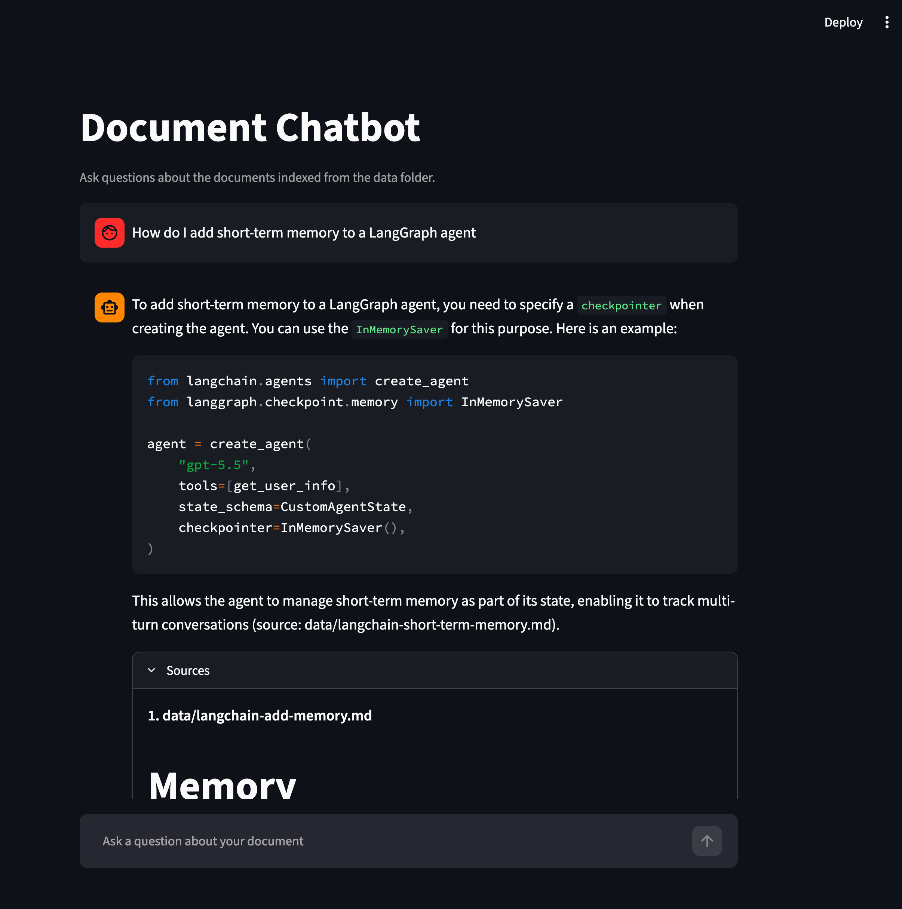

# Document Chatbot

Ask questions about your own documents and get answers grounded in them, with the source
passages it used shown alongside every response.

Built to learn how retrieval augmented generation actually works, rather than to wrap an
API and call it a chatbot.



## What it does

Put Markdown, text, or PDF files in `data/`. It splits them into chunks, converts
each chunk into a vector, and stores them locally. When you ask a question, it finds the
handful of chunks most similar to your question and asks a language model to answer using
only those.

If the answer isn't in your documents, it says so instead of inventing one. Follow-up
questions like "and what about the second one?" work too, because they are rewritten into
standalone questions before searching.

The repo ships with five pages of LangChain documentation in `data/` so there is something
to ask about straight away. See [data/SOURCES.md](data/SOURCES.md) for where they came from.

## How it works

1. `ingest.py` reads every supported file in `data/`
2. Splits them into overlapping ~750 character chunks
3. Converts each chunk to an embedding, a vector capturing its meaning
4. Stores chunks and vectors in a local Chroma database
5. In `app.py`, if there is earlier conversation, the model first rewrites your question so
   it stands on its own ("the second one" becomes the thing it refers to)
6. That question is embedded the same way and the 6 nearest chunks are retrieved
7. Those chunks go to the model inside a prompt that forbids answering from anything else

The question-time path starts at `answer_question()` in `app.py`, about 30 lines.

The Sources panel shows you exactly which chunks were used, so you can check whether the
answer is actually supported by them.

## Setup

You need Python 3.10 or newer and an OpenAI API key. The API is paid; see Cost below for how
little this uses. On macOS the built-in `python3` may be 3.9, which is too old for the pinned
dependencies. Check with `python3 --version` and install a newer Python from python.org or
Homebrew if needed.

```bash
python3 -m venv .venv
source .venv/bin/activate
pip install -r requirements.txt
cp .env.example .env      # then add your OpenAI API key
```

Then:

```bash
python ingest.py          # build the index from data/
streamlit run app.py      # start the app
```

`vectorstore/` is gitignored, so **a fresh clone has no index**. Running `ingest.py` is a
required step, not an optional one. The app will tell you if you skip it.

## Evaluating it

`evals/questions.yaml` holds 26 questions: 18 the documents answer and 8 they don't, which
the app must decline, three of them near misses on topics the documents discuss without
answering. `evals/run.py` asks each one and checks two things separately: whether
the answer mentions the key terms, and whether retrieval found the right source file.
Retrieval usually gets worse before answers visibly do, so that second check is the early
warning.

```bash
python evals/run.py               # every question
python evals/run.py trim          # only questions whose id contains "trim"
RETRIEVAL_K=4 python evals/run.py # try a different number of retrieved chunks
```

The number of chunks retrieved was chosen this way. Sweeping it scored 21/23 at k=4 and
22/23 at k=6, 8, and 10, so 6 is where the gain arrives and where it stops. Chunk size was
chosen the same way: at 1000 characters one answer ranked 15th and was never retrieved, and
750 brought it to first and the full set to 23/23. A full run costs under a cent.

The unit tests need no API key. Run them from the repo root:

```bash
python -m unittest discover -s tests -v
```

## Cost

Uses `text-embedding-3-small` for embeddings and `gpt-4o-mini` for answers. Indexing the
bundled ~180 KB of documents costs around a tenth of a cent. A question costs roughly
$0.0004, most of it the six retrieved chunks sent to the model, so a dollar buys around
2,500 questions. Follow-ups make one extra, smaller call to rewrite the question. These are
estimates from token counts at OpenAI's published prices, not measured bills.

## What I learned building this

**Retrieval and grounding are separate mechanisms, and only one of them is search.**
Ask something the documents don't cover and it still retrieves 6 chunks, because similarity
search has no concept of "no match." It returns the least-bad options every time. The
refusal comes entirely from the prompt, not the retrieval.

**This architecture cannot summarize a corpus.** Nothing in the pipeline ever reads all the
chunks. Ask it to summarize everything and it will confidently summarize the handful of chunks it
happened to retrieve, which reads exactly like a complete answer. Asking a specific question
retrieves specific content; asking a vague one retrieves vague content.

**Junk in the corpus competes for retrieval slots.** The documentation pages here opened
with a boilerplate header addressed to an LLM. It was the only text in the corpus discussing
documentation in the abstract, so it beat real content on precisely the broad questions where
a wasted slot hurts most, taking 2 of 4 slots (the app retrieved 4 at the time). Stripping
it changed the answers noticeably.

**A chunk's embedding describes everything in the chunk, not its best sentence.** Asked what
changed about "the return type of chat model invocation", nearly the documentation's exact
words, retrieval still missed: the answer was a short section sharing a 1000-character chunk
with import examples and a Python version note, so the chunk's vector mostly described those.
It ranked 15th. Stripping links and markup made it worse, because the chunk boundaries moved
and pushed the answer behind even more unrelated code. Smaller chunks fixed it. Going too small
(300) broke two other answers by splitting them across chunks.

**A passing eval check can be passing by luck.** One question required the word "delete",
which the documents use only in a code comment; their actual advice is to "prune". It passed
for weeks, then failed a correct answer the moment chunking changed which text the model saw.

**Two embedding models with the same vector size fail silently.** The old default,
`text-embedding-ada-002`, and `text-embedding-3-small` are both 1536 dimensions. Embedding
documents with one and questions with the other raises no error at all and simply returns
wrong matches. Both files pin the model explicitly, with comments explaining why they must
agree.

**Follow-up questions break retrieval, not just comprehension.** "How do I add the second
one?" shares no words with the documents that answer it, and retrieval happens before the
model sees anything. Passing history to the answering model alone would fix understanding
while still fetching the wrong chunks. Rewriting the question first fixes both, but only if
the rewritten question goes to the answering model as well. Sending it to the retriever and
the raw one to the model let the two resolve "the second one" differently: right documents,
wrong question answered, no error anywhere.

**A delimiter is only as strong as the documents allow.** The prompt wraps retrieved text in
`<context>` tags and tells the model everything inside is untrusted. But the bundled LangChain
docs contain their own example prompts with a literal `</context>` in them, so a retrieved
chunk could close the block early and the rest would read as if the user had written it. The
tags are now escaped in document text before it goes into the prompt. That makes the defense
harder to break, not unbreakable.

## Project layout

```text
app.py             Streamlit chat interface and the question-answering logic
ingest.py          Document loading and indexing
data/              Documents to index, plus SOURCES.md (attribution, not indexed)
evals/             Question set and the script that scores the app against it
tests/             Offline unit tests for the parts that don't call a model
docs/              Screenshot for this README
vectorstore/       Local Chroma database, created by ingest.py, gitignored
ROADMAP.md         Planned work and known issues
```

## Adding your own documents

Drop `.md`, `.txt`, or `.pdf` files into `data/` and re-run `python ingest.py`. Re-running is
safe and repeatable; it clears the collection before rebuilding. If you replace the bundled
documents, the eval set will no longer apply, since its questions are about them.

PDFs need a real text layer. Scanned or photographed pages have none, so their text extracts
as empty and they are silently left out of the index. If no file in `data/` yields any text,
`ingest.py` stops with an error and leaves the existing index alone. PDF loading is also the
least tested path: the bundled corpus is all Markdown.

## Limitations

- Conversation history lives in the Streamlit session, so it resets when you refresh the page.
- Adding documents means copying files and running a terminal command; there is no upload.
- The bundled documents are a snapshot from 2026-08-04 and will drift from the live LangChain
  docs.

## Next steps

See [ROADMAP.md](ROADMAP.md). The most interesting one is running the same pipeline against a
local Ollama model and comparing answer quality, speed, and cost against the API, using the
eval set to keep the comparison honest.

## License

The code is MIT licensed; see [LICENSE](LICENSE). The documents in `data/` are LangChain's
documentation, also MIT licensed, copyright LangChain. [data/SOURCES.md](data/SOURCES.md)
lists where each one came from and includes their license.
